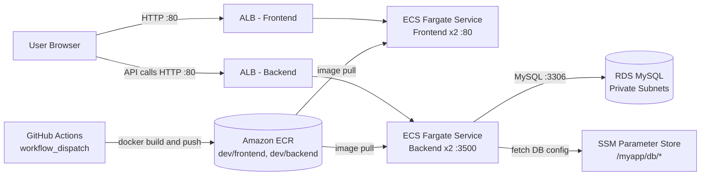

# Three-Tier School Portal on AWS ECS (Fargate) with GitHub Actions CI/CD

A containerized three-tier web application (Frontend + Backend API + MySQL database) deployed on **AWS ECS Fargate**. Docker images are built and pushed to **Amazon ECR** by **GitHub Actions**. The database runs on **Amazon RDS**, and database credentials are fetched at runtime from **AWS Systems Manager (SSM) Parameter Store**.

> **One-line summary:** Custom VPC → RDS in private subnets → Docker images in ECR (built by GitHub Actions) → ECS Fargate services behind Application Load Balancers → app reads DB config from SSM Parameter Store.

---

## Table of Contents
1. [What this project is](#1-what-this-project-is)
2. [Architecture](#2-architecture)
3. [Tech stack and why each piece](#3-tech-stack-and-why-each-piece)
4. [The application](#4-the-application)
5. [Network design (VPC)](#5-network-design-vpc)
6. [Database layer (RDS)](#6-database-layer-rds)
7. [Secrets management (SSM Parameter Store)](#7-secrets-management-ssm-parameter-store)
8. [Container images (Dockerfile + ECR)](#8-container-images-dockerfile--ecr)
9. [CI/CD pipeline (GitHub Actions)](#9-cicd-pipeline-github-actions)
10. [ECS concepts used](#10-ecs-concepts-used)
11. [Deployment order (step by step)](#11-deployment-order-step-by-step)
12. [Security groups and traffic flow](#12-security-groups-and-traffic-flow)
13. [Troubleshooting with ECS Exec](#13-troubleshooting-with-ecs-exec)
14. [Cost](#14-cost)
15. [Cleanup order](#15-cleanup-order)
16. [Limitations and what I would improve (production readiness)](#16-limitations-and-what-i-would-improve-production-readiness)
17. [ECS vs Kubernetes: when to choose which](#17-ecs-vs-kubernetes-when-to-choose-which)
18. [Interview cheat sheet](#18-interview-cheat-sheet)

---

## 1. What this project is

A **school attendance / school portal** application that performs CRUD operations on **students** and **teachers**. The application itself is deliberately simple. The real focus of the project is **how to deploy a three-tier app on a managed container platform (ECS)** without managing servers or a Kubernetes cluster.

**Goals**
- Understand ECS building blocks: cluster, task definition, service, task.
- Build a CI pipeline that builds Docker images and pushes them to a private registry.
- Run a database in private subnets and connect to it securely from containers.
- Load-balance and health-check the services.
- Learn how to troubleshoot a running container (ECS Exec).

The project was first built manually through the AWS Console ("ClickOps") so each required resource is understood. The same setup can then be converted to Terraform.

---

## 2. Architecture



**Plain-text flow**
```
Browser ──► ALB (frontend) ──► Frontend containers (Fargate, port 80)
Browser ──► ALB (backend)  ──► Backend containers  (Fargate, port 3500) ──► RDS MySQL (private subnets)
                                         └──► SSM Parameter Store (DB host/user/password/name)

GitHub Actions ──► builds Docker images ──► pushes to ECR ──► ECS pulls images when tasks start
```

> **Important design detail:** The frontend is a static site whose JavaScript runs **in the user's browser**. The backend URL is baked into the frontend image at build time (`API_BASE_URL`). So the *browser* calls the backend load balancer directly, which means the backend ALB must be reachable from the internet. The frontend container does not proxy to the backend.

---

## 3. Tech stack and why each piece

| Layer | Technology | Why |
|---|---|---|
| Compute | **ECS on Fargate** | Serverless containers. No EC2 to patch or scale, pay per vCPU/memory used. |
| Registry | **Amazon ECR** | Private, IAM-integrated image registry. Repos: `dev/backend`, `dev/frontend`. |
| Database | **RDS MySQL** (8.4, `db.t4g.micro`, 20 GB) | Managed DB, in private subnets, free-tier friendly. |
| Secrets/config | **SSM Parameter Store** (SecureString) | Free for standard parameters. Keeps credentials out of the image and out of the code. |
| Load balancing | **Application Load Balancer** (one per service) | Layer 7, health checks, spreads traffic across tasks. |
| CI/CD | **GitHub Actions** | Builds and pushes images on manual trigger (`workflow_dispatch`). |
| Networking | **Custom VPC** | 2 AZs, public and private subnets, NAT gateway. |
| Backend | **Node.js** | REST API for students and teachers. |
| Frontend | Static HTML/CSS/JS | Calls the backend API from the browser. |

---

## 4. The application

### Backend (Node.js, port **3500**)
- Reads DB connection details from **SSM Parameter Store** at startup.
- On first connect it **creates the tables automatically**, so there is no manual schema step.
- Exposes health endpoints and CRUD routes.

| Route | Purpose |
|---|---|
| `GET /health` | Basic liveness check (returns status OK, service name, uptime). **Used by the ALB target group.** |
| `GET /health/db` | Verifies the DB connection (returns 200 if the connection works). |
| `GET /` and `GET /student`, `GET /teacher` | List records. |
| `POST` add student / teacher | Create records. |
| `DELETE` student / teacher | Delete records. |

### Frontend (port **80**)
- Plain static pages (index, student, teacher) plus `student.js` / `teacher.js`.
- JavaScript uses an **API base URL** (injected at Docker build time) to call the backend.

---

## 5. Network design (VPC)

Created a dedicated VPC (`project-ECS-VPC`) instead of using the default VPC.

- **2 Availability Zones**
- **2 public subnets** and **2 private subnets** (4 subnets total)
- **Internet Gateway** attached, public route table → IGW
- **1 NAT Gateway (zonal, single AZ)**, private route tables → NAT. This lets private resources reach the internet (for example to pull images) and keeps cost down. A regional NAT per AZ would be more resilient but more expensive.
- **VPC endpoints: skipped** to keep the setup simple. In production, endpoints for ECR, S3, SSM and CloudWatch Logs avoid NAT traffic costs and keep traffic on the AWS network.

**Validation checklist used**
- Public subnets: auto-assign public IPv4 enabled, route to IGW.
- Private subnets: auto-assign public IPv4 **disabled**, route to NAT.
- Route table associations checked per subnet.

---

## 6. Database layer (RDS)

1. **DB subnet group** (`ECS-DB-subnet-group`): includes only the **two private subnets** across 2 AZs, so the DB is never reachable from the internet.
2. **RDS instance**: MySQL 8.4, free-tier template, `db.t4g.micro`, 20 GB storage, auto-generated master password.
3. **Dedicated security group** for RDS (`ECS-RDS-SG`): inbound **MySQL/Aurora TCP 3306**, source = another **security group** (not an IP range). Only resources in that SG can talk to the DB.

> Note: A DB's VPC cannot be changed after creation, so the VPC and subnet group must be right first. RDS is created **first** because it takes the longest.

---

## 7. Secrets management (SSM Parameter Store)

Four **SecureString** parameters under the path `/myapp/db/`:

| Parameter | Value |
|---|---|
| `/myapp/db/host` | RDS endpoint |
| `/myapp/db/user` | DB username (admin in this demo) |
| `/myapp/db/password` | DB password |
| `/myapp/db/name` | Database name (`school`) |

**Why Parameter Store:** standard parameters are free, and the app code fetches them at startup. Credentials never appear in the Docker image, the repo, or the task definition. Alternatives: AWS Secrets Manager (automatic rotation, paid) or HashiCorp Vault.

The **ECS task execution role** needs SSM read permission to fetch these.

---

## 8. Container images (Dockerfile + ECR)

### ECR repositories
Two private repos using a namespace for the environment:
- `dev/backend`
- `dev/frontend`

(Image scanning can be enabled; skipped here for simplicity.)

### Backend Dockerfile highlights
- **Multi-stage build** → smaller final image.
- `npm ci` (not `npm install`) → reproducible installs from the lock file.
- Dependencies copied before app code → better Docker layer caching.
- Runs as a **non-root user** → security best practice.
- Starts the app with `CMD`.
- Uses an older Node base image, which the app code is compatible with.

### Image tagging
Images are tagged with `github.run_number` (for example `:9`), which gives traceable, unique versions. Using `latest` is avoided because it is not reproducible.

---

## 9. CI/CD pipeline (GitHub Actions)

Two workflows: **Backend build & push** and **Frontend build & push**. They work the same way.

**Trigger:** `workflow_dispatch` (manual). You choose the branch (`ecs-deployment`) when you run it.

**Steps**
1. **Checkout** the repository.
2. **Configure AWS credentials** (from GitHub Secrets) in the chosen region.
3. **Login to ECR**.
4. **Build and push** using `docker/build-push-action`:
   - `context`: `backend/` or `frontend/` folder
   - `push: true`
   - tag: `<account>.dkr.ecr.<region>.amazonaws.com/dev/<service>:${{ github.run_number }}`

**Frontend-only detail:** a **build argument** (`API_BASE_URL`) is passed at build time. It is stored as a GitHub secret and set to `http://<backend-ALB-DNS>`. This is why the backend must be deployed *before* the frontend image is built.

**Secrets used**
- `AWS_ACCESS_KEY_ID`, `AWS_SECRET_ACCESS_KEY` (demo only)
- `API_BASE_URL`

> **Best practice (not used here):** Use **GitHub OIDC** with an IAM role instead of long-lived access keys. Access keys were used because an OIDC provider already existed for another personal project. Keys should be deleted after the project.

**Scope note:** This pipeline covers **CI (build + push)**. Deploying a new image to ECS is done manually by creating or updating the task definition revision and service. A full CD step would register a new task definition revision and update the service from the pipeline.

---

## 10. ECS concepts used

| Concept | Meaning | In this project |
|---|---|---|
| **Cluster** | Logical grouping of capacity | `ECS-demo`, Fargate only (no EC2 to manage) |
| **Task Definition** | Blueprint of the container(s): image, CPU, memory, ports, roles | `backend-TD`, `frontend-TD` (0.5 vCPU, 1 GB each) |
| **Task** | A running instance of a task definition (like a Pod) | 2 per service |
| **Service** | Keeps the desired number of tasks running, handles networking and load balancer registration, rolling updates | `backend` and `frontend` services, desired count 2 |
| **Task execution role** | IAM role ECS uses to pull images, write logs, and read SSM | Has the ECS task execution policy, plus SSM read access |

**Fargate vs Fargate Spot:** On-demand Fargate is used. Spot is cheaper but can be interrupted, so it is only suitable for dev or non-critical workloads.

**Deployment strategy:** Rolling update (default). ECS also supports blue/green and canary.

**ECS Exec:** enabled on both services, so you can open a shell in a running container for troubleshooting.

### Task definition details
| Setting | Backend | Frontend |
|---|---|---|
| Launch type | Fargate | Fargate |
| CPU / Memory | 0.5 vCPU / 1 GB | 0.5 vCPU / 1 GB |
| Image | `dev/backend:<run_number>` | `dev/frontend:<run_number>` |
| Container port | **3500** | **80** |
| Env vars | none (config via SSM) | none (API URL baked at build time) |

### Service details
| Setting | Backend | Frontend |
|---|---|---|
| Desired tasks | 2 | 2 |
| VPC | `project-ECS-VPC` (must be selected manually, as it defaults to the default VPC) | same |
| Subnets | private subnets | public subnets |
| Load balancer | ALB `ECS-LB-backend`, listener 80 | ALB `ECS-LB-frontend`, listener 80 |
| Target group | `ECS-TG-backend`, port 3500, health check `/health` | `ECS-TG-frontend`, port 80, health check `/health` |

---

## 11. Deployment order (step by step)

The order matters because of dependencies:

1. **VPC**: subnets, route tables, IGW, NAT gateway.
2. **RDS**: DB subnet group → RDS instance → configure RDS security group. (Do this first; it takes the longest.)
3. **SSM parameters**: host, user, password, name (after you have the RDS endpoint).
4. **ECR repositories**: `dev/backend`, `dev/frontend`.
5. **Build and push backend image** via GitHub Actions.
6. **ECS cluster** (Fargate).
7. **Backend task definition → backend service** (with ALB). Check the logs to confirm the app connected to RDS ("table is ready / database verified").
8. **Get backend ALB DNS → set `API_BASE_URL` GitHub secret** (with `http://`).
9. **Build and push frontend image** via GitHub Actions (backend URL gets baked in).
10. **Frontend task definition → frontend service** (with its own ALB).
11. **Fix security group rules** (see next section), then open the frontend ALB DNS in the browser and test add / list / delete.

---

## 12. Security groups and traffic flow

| Security group | Inbound rule | Purpose |
|---|---|---|
| RDS SG | TCP 3306 from the app's security group | Only the application can reach the database |
| App / default SG | HTTP from the ALB / internet as needed | Allow load balancer traffic to the containers |

**Key concept:** Referencing a **security group as the source** (instead of an IP/CIDR) means any resource attached to that SG is allowed, regardless of its IP. This is ideal for containers whose IPs change.

**A problem hit during the project:** The frontend site was not reachable at first because the inbound rule on the shared default security group was not correct. For the demo it was opened to all traffic. **This is a shortcut for testing only.** In production, use separate SGs (ALB SG → app SG → DB SG) with minimum necessary ports.

---

## 13. Troubleshooting with ECS Exec

1. Cluster → Service → **Task** → Container → click **Connect** (enabled only if ECS Exec is on).
2. AWS CloudShell opens and runs `aws ecs execute-command ...` automatically.
3. You land in `/app` and can inspect files (`server.js`, `package.json`, `node_modules`, Dockerfile).
4. Test the app from inside: call the `/health` endpoint locally.

Other tools:
- **CloudWatch Logs** per task (shows startup logs, DB connection status).
- **Target group health** (shows whether the ALB considers the tasks healthy).
- **Service events tab** (shows deployment and placement errors).

---

## 14. Cost

Approximately **$4–5** if the project is completed and cleaned up within 4–10 hours. The main contributors are the NAT gateway, the load balancers, and Fargate task hours. RDS free tier and SSM standard parameters cost nothing. **Always clean up after finishing.**

---

## 15. Cleanup order

Delete in this order to avoid dependency errors:

1. ECS services and the ECS cluster
2. Task definitions (deregister)
3. Load balancers
4. Target groups
5. RDS instance (and its subnet group)
6. Then ECR repos, NAT gateway / Elastic IP, VPC, SSM parameters, security groups
7. Delete the AWS access keys stored in GitHub secrets

---

## 16. Limitations and what I would improve (production readiness)

| Current state | Improvement |
|---|---|
| Built manually in the console | Rebuild with **Terraform** (VPC, RDS, ECR, ECS, ALB, IAM modules) |
| Static AWS access keys in GitHub | Use **GitHub OIDC** with an IAM role |
| CI only (build + push) | Add **CD**: register a new task definition revision and update the service from the pipeline |
| HTTP only | Add a domain (Route 53), **ACM certificate**, HTTPS listeners. Note: once the frontend is HTTPS, the API must be HTTPS too (mixed-content block) |
| Wide-open security group during testing | Separate SGs per tier with least privilege |
| Admin DB user used by the app | Create a dedicated, limited DB user |
| SSM full access on the task role | Scope down to read-only on `/myapp/db/*` |
| Backend ALB is public | Needed here because the browser calls the API. Better: serve both behind one ALB or CloudFront with path-based routing (`/api` → backend), or use an internal ALB with a proxy layer |
| No autoscaling | Add **ECS Service Auto Scaling** (CPU/memory/request-count target tracking) |
| No container-level health check or resource limits | Add health checks and CPU/memory limits in the task definition |
| No image scanning | Enable ECR scanning and add a security scan (Trivy) in the pipeline |
| Single NAT gateway | One NAT per AZ for HA, or VPC endpoints to cut NAT usage |
| RDS single-AZ | Enable Multi-AZ, backups, and deletion protection |
| No monitoring | CloudWatch alarms and dashboards, Container Insights |
| Rolling update only | Blue/green deployments via CodeDeploy for safe rollbacks |

---

## 17. ECS vs Kubernetes: when to choose which

- **ECS** is AWS-managed and simple. You work with task definitions, services and deployments, and there is no cluster upgrade burden. It has built-in rollback and tight AWS integration. It is a good fit for a limited number of containers or services, and a small team.
- **Kubernetes (EKS)** is more powerful and portable: HPA/VPA, ConfigMaps, Secrets, service mesh, a rich ecosystem. It requires more knowledge (scaling, networking, DNS, upgrades).
- Many organizations still run on ECS because migrating stable production workloads is costly and risky. A platform engineer picks the tool that fits the requirement, not the one that is trendy.

---

## 18. Interview cheat sheet

### 30-second pitch
> "I deployed a three-tier application on AWS ECS Fargate. I built a custom VPC with public and private subnets, put a MySQL RDS instance in the private subnets, and stored DB credentials in SSM Parameter Store. GitHub Actions builds the Docker images and pushes them to ECR. The frontend and backend run as separate ECS services on Fargate behind Application Load Balancers, with health checks on a `/health` endpoint. I enabled ECS Exec for troubleshooting and used security-group-to-security-group rules to lock down database access."

### 2-minute walkthrough
1. **Network first.** Custom VPC, 2 AZs, public and private subnets, IGW for public, NAT for private egress.
2. **Data layer.** RDS MySQL in private subnets via a DB subnet group, with an SG that only allows 3306 from the application's SG.
3. **Config and secrets.** Four SecureString parameters under `/myapp/db/`. The backend fetches them at startup, so nothing sensitive is in the image.
4. **Images.** Multi-stage Dockerfile, non-root user, `npm ci`. Tagged with the GitHub run number, pushed to private ECR repos.
5. **CI.** GitHub Actions workflow (manual dispatch) does checkout, AWS auth, ECR login, build and push. The frontend gets the backend URL as a build arg.
6. **Runtime.** ECS cluster on Fargate, a task definition per service (CPU, memory, image, port, execution role), and a service per tier with 2 tasks and an ALB with health checks.
7. **Validation and ops.** Checked target health, CloudWatch logs for the DB connection, tested CRUD from the browser, and used ECS Exec to troubleshoot.

### Likely questions and answers

**Q: What is the difference between a task definition and a service?**
A task definition is the blueprint (image, CPU, memory, ports, roles). A service runs and maintains a desired number of tasks from that blueprint, attaches them to a load balancer, and handles rolling deployments and restarts.

**Q: Why Fargate instead of EC2 launch type?**
No servers to manage or patch, per-task billing, and simpler scaling. EC2 gives more control and can be cheaper at steady high utilization.

**Q: How does the backend get DB credentials securely?**
From SSM Parameter Store (SecureString) at startup, using the ECS task's IAM permissions. Nothing is hardcoded in the image or repo.

**Q: How is the database protected?**
It sits in private subnets with no public access, and its security group only allows port 3306 from the application's security group.

**Q: What does the task execution role do?**
It lets ECS pull images from ECR, send logs to CloudWatch, and (here) read parameters from SSM. It is separate from a task role, which is for permissions the application code itself needs.

**Q: How do you roll back a bad deployment?**
Point the service at the previous task definition revision. Images are tagged by run number, so the old version still exists in ECR. For safer releases, use blue/green with CodeDeploy.

**Q: Why use `npm ci` and a multi-stage build?**
`npm ci` gives reproducible installs from the lock file. A multi-stage build keeps build tooling out of the final image, so it is smaller and has fewer vulnerabilities.

**Q: Why is the backend ALB public?**
The frontend is static JavaScript running in the user's browser, so the browser calls the API directly. A better pattern is to put both behind one ALB or CloudFront with path-based routing.

**Q: Why did the frontend not load at first?**
The security group inbound rule was wrong, so the ALB or user traffic was blocked. I fixed it by correcting the inbound rule (opened wide for the demo). In production I would use tier-specific SGs.

**Q: How would you scale this?**
ECS Service Auto Scaling (target tracking on CPU, memory or ALB request count per target), and RDS read replicas or Multi-AZ for the database.

**Q: How would you automate the infrastructure?**
Terraform modules for the VPC, RDS, ECR, ECS (cluster, task definitions, services), ALBs, IAM roles and SSM parameters, with the pipeline updating the task definition image on each release.

**Q: ECS or EKS?**
For a small number of services with modest scaling needs, ECS is simpler and cheaper to operate. EKS makes sense when you need Kubernetes features (HPA/VPA, service mesh, portability) and have the expertise.

### Key numbers to remember
- Backend port **3500**, frontend port **80**, MySQL **3306**
- 2 AZs, 4 subnets (2 public, 2 private), 1 NAT gateway
- 2 tasks per service, 0.5 vCPU / 1 GB each
- Health check path `/health`
- SSM path `/myapp/db/{host,user,password,name}`
- ECR repos `dev/backend`, `dev/frontend`
- Cost about $4–5 for the full exercise

---

## Credits
Built by following a hands-on ECS tutorial, then documented in my own words for revision and interviews. Application code is on the `ecs-deployment` branch.


This repository demonstrates the deployment of a three-tier application using Docker, focusing on individual Dockerfiles for each component. The application comprises a MySQL database, a Node.js backend, and a React.js frontend.

## Prerequisites

Before you begin, ensure that you have the following installed:

- [Docker](https://www.docker.com/get-started)

## Project Structure

- **backend**: Node.js application serving as the backend.
- **frontend**: React.js application for the frontend.
- **mysql**: Dockerfile and configurations for the MySQL database.

## Deployment Steps

1. **MySQL Database:**

   - Navigate to the `mysql` directory.
   - Build the MySQL Docker image:
     ```bash
     docker build -t mysql-image .
     ```
   - Run the MySQL container:
     ```bash
     docker run --name mysql-container --network=three-tier-network -p 3306:3306 -v mysql-data:/var/lib/mysql -d mysql-image
     ```
   - Access the MySQL container:
     ```bash
     docker exec -it mysql-container /bin/bash
     ```
   - Inside the container, create tables for the database:
     ```sql
     USE school;
     CREATE TABLE student (id INT AUTO_INCREMENT PRIMARY KEY, name VARCHAR(40), roll_number INT, class VARCHAR(16));
     CREATE TABLE teacher (id INT AUTO_INCREMENT PRIMARY KEY, name VARCHAR(40), subject VARCHAR(40), class VARCHAR(16));
     ```

2. **Backend Application:**

   - Navigate to the `backend` directory.
   - Build the backend Docker image:
     ```bash
     docker build -t backend .
     ```
   - Run the backend container:
     ```bash
     docker run -d -p 3500:3500 --name backend-container --network=three-tier-network backend
     ```

3. **Frontend Application:**

   - Navigate to the `frontend` directory.
   - Build the frontend Docker image:
     ```bash
     docker build -t frontend .
     ```
   - Run the frontend container:
     ```bash
     docker run -d --name frontend-container --network=three-tier-network -p 80:80 frontend
     ```

4. **Access the Application:**

   Open your favorite browser and visit [http://localhost:80](http://localhost:80). Enjoy exploring the MERN stack application!

   

   

   

   

   


   


## Data Persistence

Data persistence is ensured by using Docker volumes. If the MySQL container is deleted, data remains available and is automatically added to a new Docker container by providing the same Docker volume.

Feel free to explore and modify the Dockerfiles to enhance your understanding of containerization and deployment! Happy coding! 🚀
